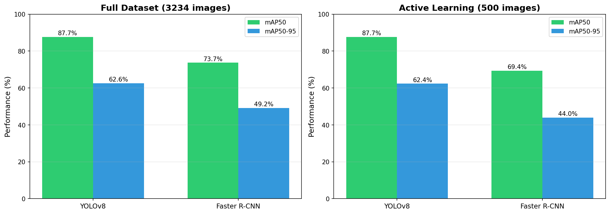
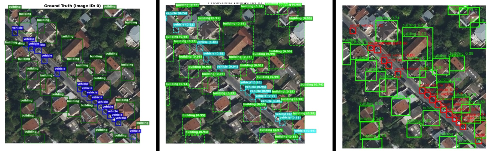
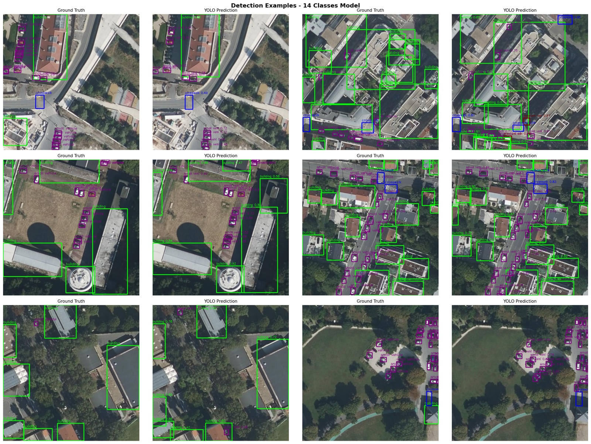
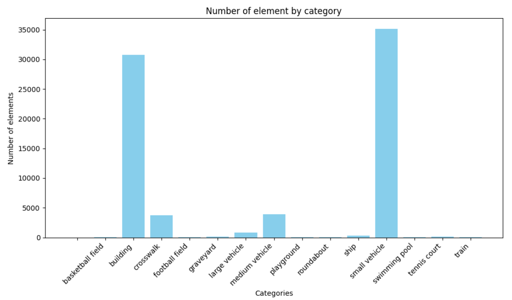

# Aerial Object Detection on CADOT

[](https://github.com/EliottCanville/aerial-object-detection/actions/workflows/lint.yml)
[](https://www.python.org/)
[](https://pytorch.org/)
[](https://docs.ultralytics.com/)
[](report.pdf)
[](https://github.com/EliottCanville/aerial-object-detection/releases/tag/v1.0.0)

We benchmark a one-stage detector (**YOLOv8**) against a two-stage detector (**Faster R-CNN**, ResNet-50 + FPN) on
[CADOT](https://cadot.onrender.com/), the dense urban aerial dataset of the IEEE ICIP 2025 Grand Challenge
(Paris, 20 cm/pixel, 14 object classes). The study is organized as three experiments of increasing difficulty:

1. **Baseline**: the two dominant classes (*building*, *small vehicle*) on the full training set.
2. **Active learning**: the same task with only 500 images, selected by **k-Center Greedy** core-set sampling on Faster R-CNN backbone features.
3. **Multi-class**: all 14 classes, with **minority-class oversampling** and a re-weighted classification loss to handle a class imbalance above 1000:1.

The full write-up is available in [`report.pdf`](report.pdf).

## Results

Validation-set mAP (%), IoU 0.50 / 0.50:0.95.

| Experiment | Training images | Classes | YOLOv8n | Faster R-CNN |
|---|---:|:---:|:---:|:---:|
| 01 · Full dataset | 3,234 | 2 | **87.7** / **62.6** | 73.7 / 49.2 |
| 02 · Active learning (k-Center Greedy) | 500 | 2 | **87.7** / **60.1** | 69.4 / 44.0 |
| 03 · Oversampled, 14 classes | 2,933 (500 unique) | 14 | **73.9** / **60.5** | – |

<p align="center">
  
</p>

**Key findings**

- **YOLOv8n outperforms Faster R-CNN by 14 to 18 mAP50 points** with ~3M parameters vs ~41M, and trains in 18 minutes on a single A100. Its P3 head and Mosaic augmentation suit the hundreds of small, densely packed vehicles per tile.
- **500 core-set images (15.5 % of the training set) reach the full-dataset mAP50** with YOLOv8, at a 6.5× lower annotation budget.
- **On 14 classes, oversampling + `cls=1.0` reaches 73.9 % mAP50** (precision 82.1 %, recall 68.4 %). Frequent or distinctive classes are well recognized (small vehicle 92 %, building 89 %, basketball field 86 % recall); *roundabout* (26 %) and *crosswalk* (53 %) remain hard, and *tennis court* is often confused with *basketball field*.

<p align="center">
  
  <br><em>Same tile, left to right: ground truth, Faster R-CNN, YOLOv8 (full-dataset models).</em>
</p>

<p align="center">
  
  <br><em>14-class model on validation tiles: ground truth (left) vs prediction (right).</em>
</p>

## Pretrained models

All trained checkpoints are published in the [**v1.0.0 release**](https://github.com/EliottCanville/aerial-object-detection/releases/tag/v1.0.0)
(checksums in `SHA256SUMS.txt`).

| Model | Experiment | Classes | mAP50 | File | Size |
|---|---|:---:|:---:|---|---:|
| YOLOv8n | 01 · Full dataset | 2 | 87.7 | `yolov8n_cadot_2cls_full.pt` | 6 MB |
| YOLOv8n | 02 · Active learning | 2 | 87.7 | `yolov8n_cadot_2cls_active500.pt` | 6 MB |
| YOLOv8n | 03 · Oversampled | 14 | 73.9 | `yolov8n_cadot_14cls_oversampled.pt` | 6 MB |
| Faster R-CNN R50-FPN | 01 · Full dataset | 2 | 73.7 | `fasterrcnn_r50fpn_cadot_2cls_full.pth` | 166 MB |
| Faster R-CNN R50-FPN | 02 · Active learning | 2 | 69.4 | `fasterrcnn_r50fpn_cadot_2cls_active500.pth` | 166 MB |

Quick test on your own images (the models expect nadir aerial tiles at about 20 cm/pixel, as in CADOT):

```bash
pip install -r requirements.txt
mkdir -p weights && cd weights
curl -LO https://github.com/EliottCanville/aerial-object-detection/releases/download/v1.0.0/yolov8n_cadot_14cls_oversampled.pt
curl -LO https://github.com/EliottCanville/aerial-object-detection/releases/download/v1.0.0/fasterrcnn_r50fpn_cadot_2cls_full.pth
cd ..

python -m src.yolo.predict --weights weights/yolov8n_cadot_14cls_oversampled.pt --source path/to/images --out runs/predict/yolo
python -m src.faster_rcnn.predict --weights weights/fasterrcnn_r50fpn_cadot_2cls_full.pth --source path/to/images --out runs/predict/frcnn
```

The YOLO checkpoints are standard Ultralytics files: `YOLO("weights/yolov8n_cadot_14cls_oversampled.pt")` or
`yolo predict model=... source=...` work as well.

## Dataset

CADOT ([challenge page](https://cadot.onrender.com/), [IEEE DataPort](https://ieee-dataport.org/documents/cadot-cityscape-aerial-dataset-object-detection))
contains 4,628 aerial tiles of the Paris area annotated with 14 urban object classes. The dataset is **not
redistributed** here: download it and place it under `data/` as described below.

<details>
<summary>Classes and training-set distribution</summary>

| ID | Class | Train instances | | ID | Class | Train instances |
|---:|---|---:|---|---:|---|---:|
| 0 | basketball field | 15 | | 7 | playground | 44 |
| 1 | building | 30,764 | | 8 | roundabout | 37 |
| 2 | crosswalk | 3,751 | | 9 | ship | 300 |
| 3 | football field | 77 | | 10 | small vehicle | 35,149 |
| 4 | graveyard | 130 | | 11 | swimming pool | 60 |
| 5 | large vehicle | 841 | | 12 | tennis court | 98 |
| 6 | medium vehicle | 3,865 | | 13 | train | 67 |

<p align="center"></p>
</details>

Expected layout (only `cadot/` and `cadot_coco/` come from the download, the rest is generated by `src/data`):

```
data/
├── cadot/                 # YOLO format, original 14-class ids (see configs/classes.txt)
│   ├── train/{images,labels}    # 3,234 tiles
│   ├── valid/{images,labels}    #   929 tiles
│   └── test/images              #   465 tiles, no public labels
├── cadot_coco/            # same splits in COCO format (<split>/_annotations.coco.json), used by Faster R-CNN
├── cadot_2cls/            # building + small vehicle labels, images symlinked to cadot/
├── active500_2cls/        # 500-image core-set subset, 2 classes
├── active500_14cls/       # same subset, 14 classes
└── oversampled_14cls/     # active500_14cls after minority-class oversampling (2,933 images)
```

## Repository structure

```
├── configs/
│   ├── classes.txt              # class id -> name (reference mapping)
│   ├── datasets/                # Ultralytics dataset definitions
│   └── experiments/             # one YAML per experiment: weights + training hyperparameters
├── src/
│   ├── data/                    # label filtering, core-set subset, oversampling, class statistics
│   ├── yolo/                    # training (config-driven) and inference
│   ├── faster_rcnn/             # dataset, training, inference, k-Center Greedy core-set selection
│   └── analysis/                # training curves, run comparison, report figures
├── cluster/gricad/              # OAR job scripts for the GRICAD GPU cluster
├── experiments/                 # versioned results: metrics, curves, confusion matrices, args
│   ├── 01_baseline_full_dataset/
│   ├── 02_active_learning_500/  # includes coreset_ranking.json (k-Center Greedy order)
│   ├── 03_oversampled_14classes/
│   └── faster_rcnn/             # COCO evaluation logs
├── docs/figures/                # figures used in this README
└── report.pdf                   # final report
```

Trained weights are not tracked by git: download them from the [release](#pretrained-models) into `weights/`.

## Getting started

```bash
git clone git@github.com:EliottCanville/aerial-object-detection.git
cd aerial-object-detection
python -m venv .venv && source .venv/bin/activate
pip install -r requirements.txt
```

All commands are run from the repository root.

### 1. Prepare the data

```bash
# 14 -> 2 classes (building, small vehicle)
python -m src.data.filter_labels --src data/cadot --dst data/cadot_2cls

# Core-set ranking from Faster R-CNN backbone features (the ranking used in the report is versioned)
python -m src.faster_rcnn.coreset_selection \
    --checkpoint weights/fasterrcnn_r50fpn_cadot_2cls_full.pth \
    --images-dir data/cadot_coco/valid --out experiments/02_active_learning_500/coreset_ranking.json

# 500-image subsets, then minority-class oversampling for the 14-class experiment
python -m src.data.build_active_learning_subset --src data/cadot_2cls/valid --dst data/active500_2cls
python -m src.data.build_active_learning_subset --src data/cadot/valid --dst data/active500_14cls
python -m src.data.oversample_minority_classes --src data/active500_14cls --dst data/oversampled_14cls

# Class statistics of any label folder
python -m src.data.class_distribution data/cadot/train/labels data/active500_14cls/labels
```

### 2. Train

```bash
# YOLOv8: one config per experiment, outputs in runs/<experiment>/ (+ metrics.json)
python -m src.yolo.train configs/experiments/01_baseline_full_dataset.yaml
python -m src.yolo.train configs/experiments/02_active_learning_500.yaml
python -m src.yolo.train configs/experiments/03_oversampled_14classes.yaml

# Faster R-CNN (ResNet-50 FPN, COCO-pretrained), checkpoint saved every epoch
python -m src.faster_rcnn.train --data-root data/cadot_coco --out-dir runs/faster_rcnn
```

On GRICAD (OAR scheduler, A100), submit from a clone of the repository on `/bettik`:

```bash
oarsub -S "./cluster/gricad/train.oar.sh configs/experiments/03_oversampled_14classes.yaml"
./cluster/gricad/monitor_job.sh <job_id>                  # from your laptop
./cluster/gricad/fetch_results.sh 03_oversampled_14classes # copies the run into experiments/
```

### 3. Inference and analysis

```bash
# Annotated predictions on the test split
python -m src.yolo.predict --weights weights/yolov8n_cadot_14cls_oversampled.pt \
    --source data/cadot/test/images --out runs/predict/14cls

# Training curves, run comparison, report figures (written to report/figures/)
python -m src.analysis.plot_training --results experiments/01_baseline_full_dataset/results.csv --out runs/plots/01
python -m src.analysis.compare_runs \
    --runs experiments/01_baseline_full_dataset/results.csv experiments/02_active_learning_500/results.csv \
    --labels "Full dataset" "Active learning" --images 3234 500 --out runs/plots/comparison
python -m src.analysis.report_figures
```

## Methods in brief

| | YOLOv8n | Faster R-CNN |
|---|---|---|
| Paradigm | one-stage, anchor-free, decoupled head | two-stage: RPN + RoI Align heads |
| Backbone | CSPDarknet + PAN neck, heads P3–P5 | ResNet-50 + FPN (COCO-pretrained) |
| Input | 640 × 640 | 800 px (torchvision default) |
| Training | 50 epochs (200 for 14 classes), batch 16 | SGD lr 0.005, momentum 0.9, 10 epochs, batch 2 |

- **Core-set selection.** Each image is embedded by global-average-pooling the ResNet-50 C5 map of the trained Faster R-CNN (2048-d). k-Center Greedy repeatedly adds the image farthest from the current selection, which yields an ordering from most to least informative; the first 500 images form the subset.
- **Imbalance handling.** Images containing a minority class are duplicated with a factor `min(500 // count, 50)` (500 → 2,933 images), and the YOLO classification loss weight is doubled (`cls: 1.0`). See [`oversampling_summary.json`](experiments/03_oversampled_14classes/oversampling_summary.json).

## Authors

Project carried out in the 3rd year of the SICOM program at Grenoble INP – Phelma (2025).

- **Eliott Canville**: YOLOv8 experiments
- **Clément Melkior**: Faster R-CNN experiments and core-set selection

## References

- G. Jocher et al., *Ultralytics YOLOv8*, 2023. [docs.ultralytics.com](https://docs.ultralytics.com/)
- S. Ren, K. He, R. Girshick, J. Sun, *Faster R-CNN: Towards Real-Time Object Detection with Region Proposal Networks*, NeurIPS 2015. [arXiv:1506.01497](https://arxiv.org/abs/1506.01497)
- T.-Y. Lin et al., *Feature Pyramid Networks for Object Detection*, CVPR 2017. [arXiv:1612.03144](https://arxiv.org/abs/1612.03144)
- O. Sener, S. Savarese, *Active Learning for Convolutional Neural Networks: A Core-Set Approach*, ICLR 2018. [arXiv:1708.00489](https://arxiv.org/abs/1708.00489)
- CADOT: Cityscape Aerial Dataset for Object deTection, IEEE ICIP 2025 Grand Challenge. [cadot.onrender.com](https://cadot.onrender.com/)
